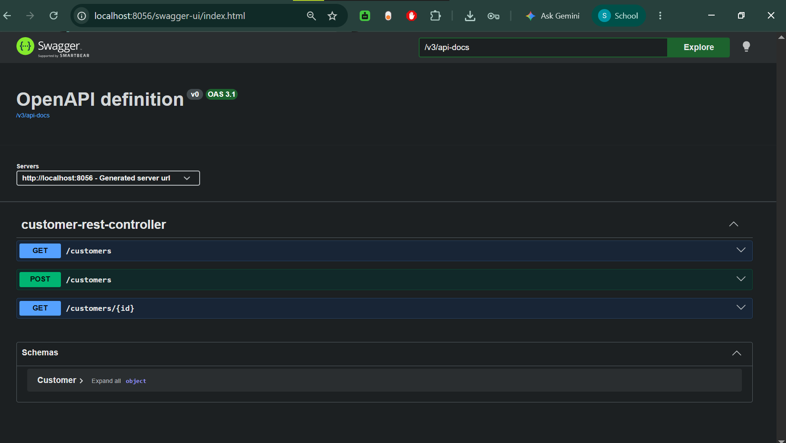
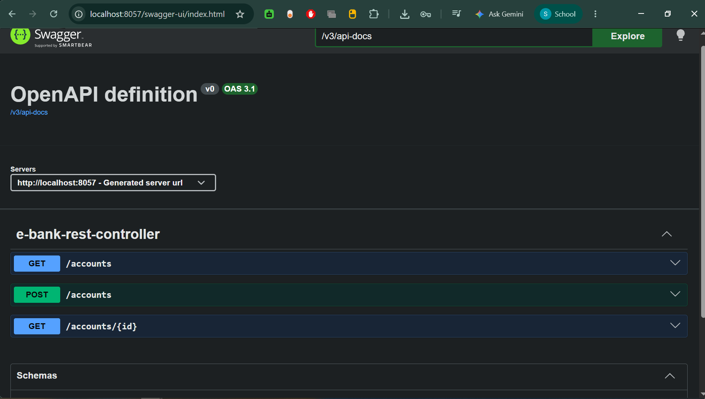
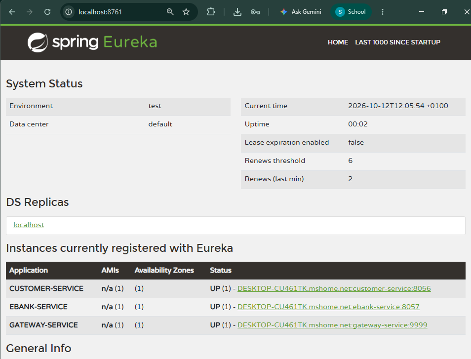
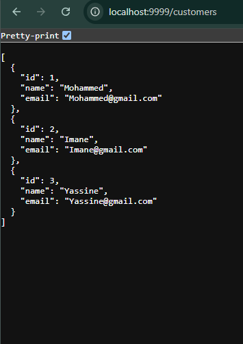
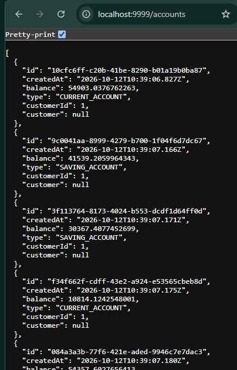
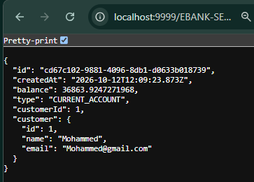
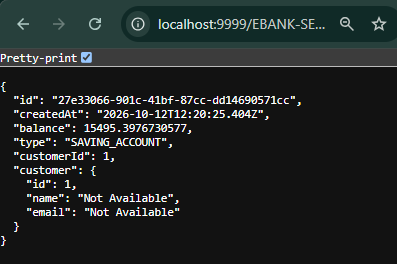

# EBank MS App - Partie 1

Cette branche correspond à la première partie du projet de microservices
présentée dans la vidéo [Développer une architecture microservices avec Spring Cloud](https://www.youtube.com/watch?v=cdFz3VemT1Q).

## Objectifs de la partie 1

- Développer `customer-service`.
- Développer `ebank-service`.
- Mettre en place la communication entre les services avec OpenFeign.
- Ajouter la tolérance aux pannes avec Circuit Breaker et Resilience4J.
- Développer une API Gateway.
- Mettre en place le service de découverte Eureka.
- Tester les APIs avec Postman et Swagger UI.

## Architecture

```text
Client REST / Swagger UI
          |
          v
   gateway-service : 9999
          |
          +--> customer-service : 8056
          |
          +--> ebank-service : 8057
                         |
                         +--> customer-service (OpenFeign)

              discovery-service : 8761
```

### Services

| Service | Port | Rôle |
|---|---:|---|
| `discovery-service` | `8761` | Registre Eureka |
| `gateway-service` | `9999` | Point d'entrée et routage dynamique |
| `customer-service` | `8056` | Gestion des clients |
| `ebank-service` | `8057` | Gestion des comptes bancaires |

## Prérequis

- Java 17 ou une version compatible avec le projet.
- Maven Wrapper inclus dans chaque service.
- Les ports `8056`, `8057`, `8761` et `9999` disponibles.

## Démarrage

Démarrer les services dans cet ordre, dans quatre terminaux séparés :

```powershell
cd discovery-service
.\mvnw.cmd spring-boot:run
```

```powershell
cd customer-service
.\mvnw.cmd spring-boot:run
```

```powershell
cd ebank-service
.\mvnw.cmd spring-boot:run
```

```powershell
cd gateway-service
.\mvnw.cmd spring-boot:run
```

Le tableau de bord Eureka est disponible à l'adresse :

```text
http://localhost:8761
```

Les services doivent apparaître comme enregistrés avant d'utiliser les routes
dynamiques du gateway.

## Endpoints

### Accès directs

```text
GET http://localhost:8056/customers
GET http://localhost:8056/customers/{id}
POST http://localhost:8056/customers

GET http://localhost:8057/accounts
GET http://localhost:8057/accounts/{id}
POST http://localhost:8057/accounts
```

### Accès via le gateway

Le locator dynamique du gateway conserve les identifiants Eureka en majuscules :

```text
GET http://localhost:9999/CUSTOMER-SERVICE/customers
GET http://localhost:9999/CUSTOMER-SERVICE/customers/{id}

GET http://localhost:9999/EBANK-SERVICE/accounts
GET http://localhost:9999/EBANK-SERVICE/accounts/{id}
POST http://localhost:9999/EBANK-SERVICE/accounts
```

Si `lower-case-service-id=true` est activé dans le gateway, utiliser à la place
`customer-service` et `ebank-service` en minuscules.

## OpenFeign et tolérance aux pannes

`ebank-service` utilise `CustomerRestClient` pour récupérer le client associé
à un compte. Le Circuit Breaker Resilience4J fournit un client par défaut
avec les valeurs `Not Available` lorsque `customer-service` est indisponible.

L'annotation `@EnableFeignClients` est activée dans
`EbankServiceApplication`.

## Swagger UI

Swagger UI est disponible directement sur chaque service :

```text
http://localhost:8056/swagger-ui/index.html
http://localhost:8057/swagger-ui/index.html
```

Les spécifications OpenAPI sont disponibles ici :

```text
http://localhost:8056/v3/api-docs
http://localhost:8057/v3/api-docs
```

## Captures d'écran

### Customer Service



### EBank Service



### Eureka



### Gateway





### Compte avec son client



### Circuit Breaker



## Tests manuels

1. Vérifier que les quatre applications démarrent sans erreur.
2. Vérifier l'enregistrement des services dans Eureka.
3. Tester les endpoints directs avec Postman ou Swagger UI.
4. Tester les mêmes endpoints via le gateway.
5. Arrêter temporairement `customer-service`, puis consulter un compte via
   `ebank-service` pour vérifier le fallback Resilience4J.

